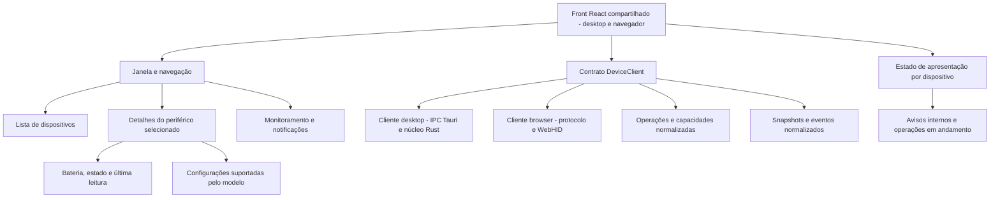
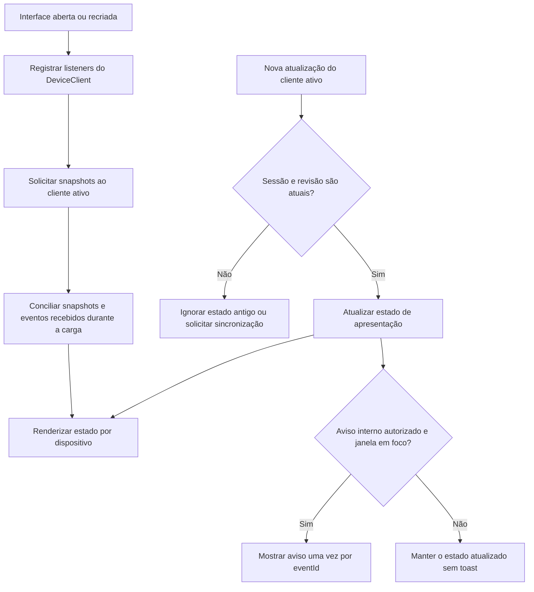
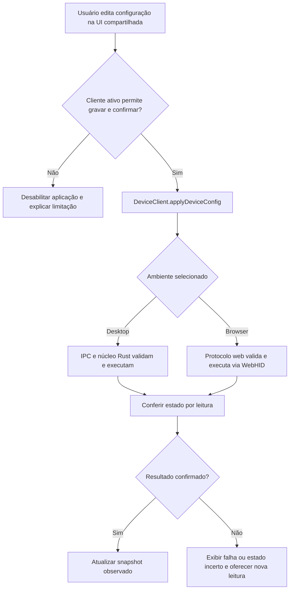
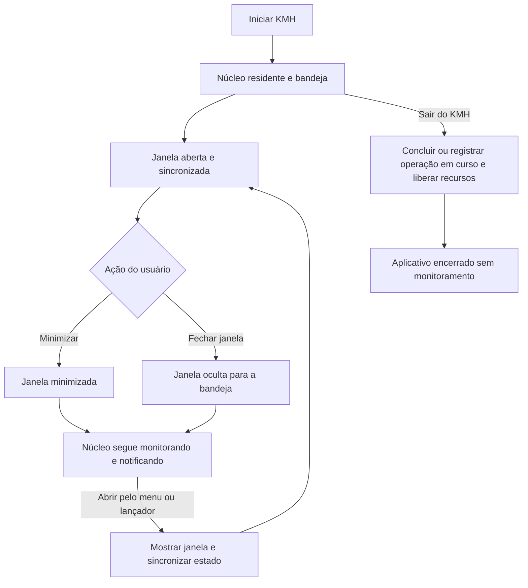

# KMH Project — Arquitetura do front

**Status: proposta de desenvolvimento, atualizada em 2026-10-17.**

O front será desenvolvido em **React + TypeScript + Vite**, com a mesma interface para **desktop Tauri 2** e **site no navegador**. Componentes, formulários e estado de apresentação serão compartilhados. O acesso aos dispositivos ficará atrás de um contrato `DeviceClient`, com implementações próprias para cada ambiente.

No desktop, o [núcleo Rust](arquitetura-nucleo.md) executa o monitoramento e a comunicação com os dispositivos. No navegador, um cliente WebHID executará somente protocolos e operações compatíveis com essa API, enquanto a página estiver ativa. O site poderá funcionar sem núcleo instalado para esses dispositivos; isso **ainda não foi validado para o MT760**. A [visão geral](arquitetura-geral.md) descreve os dois modos. Esta mudança prepara a arquitetura; os adaptadores ainda não estão implementados.

## 1. Hierarquia da interface

Uma organização inicial possível dentro de `apps/web/src` é separar `device-client` (contrato e implementações), `devices`, `settings` e componentes compartilhados conforme surgirem. O ponto de entrada recebe a implementação de `DeviceClient` e a fornece aos hooks React. Componentes não importam APIs do Tauri, `navigator.hid`, bytes HID ou caminhos do sistema.

O build desktop selecionará explicitamente o cliente IPC; o build web selecionará o cliente WebHID, verificando a disponibilidade da API antes de oferecer conexão. Falta de suporte ou permissão produz um estado explicável na tela. Uma falha do núcleo não deve provocar uma troca automática de transporte, especialmente durante uma gravação.

O pacote existente `packages/transport-webhid` será reaproveitado para o acesso WebHID após avaliar seu contrato atual. Ele não substitui o protocolo de cada modelo. O nome existente `packages/core` também não significa que o núcleo Rust já exista. Inicialmente, manter a interface em `apps/web`; extrair um pacote de UI apenas se houver necessidade de pontos de entrada separados.

Não é necessário introduzir uma biblioteca global de estado imediatamente. Contexto e hooks React podem atender à primeira versão; crescimento e requisitos concretos orientarão essa decisão.

## 2. Informações apresentadas

A lista deverá permitir distinguir mouse, teclado, headset e múltiplas unidades do mesmo tipo. Cada item usa o `deviceId` fornecido pelo cliente ativo, não o nome exibido ou apenas VID/PID. No navegador, a identidade pode ser limitada à sessão; não prometer reconhecimento persistente entre máquinas ou reconexões sem um identificador confiável.

O painel do dispositivo deverá apresentar:

- Nome, conexão e estado atual: conectado, pausado, em repouso, aguardando permissão, desconectado ou com erro.
- Informações disponíveis, como bateria, DPI e polling rate configurado.
- Instante e validade da última leitura; valor desconhecido ou não suportado não vira zero.
- Configurações editáveis apenas quando houver capacidade de escrita comprovada.
- Resultado da última operação e orientação de recuperação quando o estado for incerto.

Para o MT760, a primeira implementação pode apresentar os campos já pesquisados. Ainda não deve disponibilizar gravação de polling rate ou personalização de botões como se estivessem prontas.

## 3. Comunicação e sincronização

O `DeviceClient` centraliza operações, snapshots e eventos, mantendo a mesma terminologia da [arquitetura geral](arquitetura-geral.md). No desktop, sua implementação traduz as operações para IPC. No navegador, ela coordena o protocolo sobre WebHID e mantém o estado apenas enquanto a sessão da página existir. Componentes visuais não executam timers HID; consultas periódicas, quando necessárias e suportadas, pertencem à implementação do cliente.

### Contrato comum proposto

| Operação | Papel |
| --- | --- |
| `getEnvironment()` | Informa ambiente, disponibilidade do transporte e recursos do aplicativo |
| `requestDeviceAccess()` | Solicita seleção/permissão quando necessária; no browser deve partir de uma ação do usuário |
| `listDevices()` e `getDeviceSnapshot()` | Retornam dispositivos autorizados, capacidades, estado e validade das leituras |
| `subscribe(listener)` | Entrega eventos normalizados e retorna a função de remoção do listener |
| `applyDeviceConfig(request)` | Solicita alteração validada e retorna o resultado observado, incluindo estado incerto |
| `dispose()` | Libera listeners e recursos do cliente; no desktop não encerra o núcleo residente |

Os nomes são uma proposta, sem implementação nesta etapa. Os tipos do contrato serão independentes de Tauri e WebHID. O contrato IPC Rust deve corresponder a esses tipos; gerar os bindings ou verificar sua correspondência em vez de manter versões divergentes. No browser, a codificação dos pacotes fica na camada de protocolo, fora de React.

O snapshot mantém `deviceId`, `sessionId`, revisões e instante de leitura conforme a arquitetura do núcleo. No browser, o cliente fornece esses campos para sua própria sessão; eles não são identificadores globais nem versões fornecidas pelo firmware. O transporte escolhido permanece fixo durante a operação.

Ao abrir ou recriar a interface:

1. Registrar os listeners de eventos antes de pedir o snapshot, guardando atualizações que chegarem durante a carga.
2. Solicitar a lista e os snapshots conhecidos.
3. Conciliar os dados por `deviceId`, `sessionId` e `revision`, preservando a versão mais recente de cada sessão.
4. Processar as atualizações seguintes sem reaplicar estados antigos.
5. Solicitar novo snapshot ao detectar uma inconsistência ou restabelecer a comunicação. Eventos não são uma fila durável nem substituem a sincronização inicial.

Listeners devem ser removidos no descarte dos componentes para não duplicar avisos ao reabrir a janela. No desktop, o núcleo permanece ativo mesmo quando não há nenhum listener React. No browser, descarregar a página encerra a sessão; ao retornar, obter novas leituras antes de apresentar valores como atuais.

### Fluxo de recebimento de informações

O front não presume que uma mudança foi originada pelo clique na interface. O usuário pode ter pressionado o botão físico de DPI ou alterado o dispositivo em outro programa; o estado confirmado pelo cliente ativo prevalece sobre o último valor exibido.

## 4. Edição de configuração

A tela deve distinguir **valor observado** e **edição ainda não aplicada**. Exemplo: o dispositivo informa 1350 DPI, e o usuário preenche 1400; até o cliente ativo confirmar a gravação por leitura, o valor observado continua 1350.

Ao aplicar, o front envia `deviceId`, `sessionId`, `requestId`, `expectedConfigRevision` e os campos desejados por `applyDeviceConfig`. No desktop, o cliente traduz a chamada para `apply_device_config`; o núcleo valida novamente todos os dados. No browser, a implementação WebHID também valida parâmetros e capacidades antes de montar qualquer pacote. Se a configuração mudou desde o início da edição, a interface solicita atualização e revisão do usuário em vez de sobrescrever silenciosamente.

Durante a operação, apresentar progresso e bloquear submissões conflitantes daquele dispositivo. Dispositivos independentes podem continuar sendo acompanhados. Em erro ou perda de conexão, mostrar resultado desconhecido quando apropriado; não declarar sucesso por ter recebido apenas confirmação de envio.

O resultado deverá permitir distinguir alteração confirmada, falha sem alteração, restauração confirmada e estado incerto. No desktop, fechar a janela não deve cancelar abruptamente uma gravação que o núcleo já iniciou. No browser, o usuário deve manter a página aberta e o dispositivo conectado durante a operação; suspensão ou fechamento pode impedir a confirmação. Na próxima conexão, reler o estado, sem repetir a escrita automaticamente.

### Capacidades por dispositivo, operação e ambiente

A UI habilita controles conforme o suporte **do protocolo e do transporte ativo**, não apenas pelo modelo. Cada recurso, como leitura de bateria, gravação de tabela DPI, polling rate ou botões, informa disponibilidade e motivo da indisponibilidade. Recursos de ambiente, como bandeja e monitoramento residente, são separados das capacidades do periférico.

No browser, `sendReport()` concluir não comprova gravação. Só habilitar escrita quando for possível obter o estado original, validar os campos, enviar o comando e confirmar por leitura. Testar persistência após ciclo de energia é uma validação adicional; um ACK isolado não a comprova. Configurações salvas no armazenamento da página são preferências locais do site, não dados gravados na memória do mouse.

O teste atual do MT760 enviou uma consulta pelo WebHID sem receber `inputreport`; a resposta veio por `GET_REPORT(Input)` nativo. WebHID não expõe diretamente essa leitura. Logo, as operações que dependem dela continuam indisponíveis no modo web até validar outra rota. O experimento DPI comprovou persistência após reinício de mouse e receptor, mas não identificou em qual deles está o armazenamento. [Evidência do browser](../research/experiments/browser-telemetry.md), [experimento de escrita](../research/experiments/write-dpi.md), [API WebHID](https://developer.chrome.com/docs/capabilities/hid).

### Fluxo de aplicação compartilhado

Filas e revisões protegem apenas as operações controladas pelo mesmo cliente. No browser, múltiplas abas e outros configuradores podem concorrer com a página; reler antes e depois da escrita e recusar operações conflitantes conhecidas. Não prometer exclusão global do hardware nem usar revisão local como prova de que nenhum outro programa alterou o dispositivo.

## 5. Janela minimizada, oculta e aplicativo encerrado

**Esta seção descreve o aplicativo desktop.** No site, fechar a aba encerra o acesso; minimizar ou colocar a aba em segundo plano não garante monitoramento contínuo. Instalar a página como PWA não fornece as capacidades nativas que faltam ao WebHID.

Esses estados têm comportamentos diferentes. O gerenciamento da janela e da bandeja ficará no lado nativo do Tauri, para não depender do ciclo de vida do React.

| Ação | Interface | Núcleo |
| --- | --- | --- |
| Minimizar | Janela minimizada pelo sistema | Continua ativo |
| Fechar a janela | Ocultar para a bandeja na política inicial | Continua ativo |
| Abrir pelo menu ou iniciar outra instância | Mostrar/reabrir a janela da instância existente | Mantém as sessões existentes |
| Sair do KMH | Encerrar a interface | Finalizar tarefas com segurança e liberar dispositivos |
| Encerrar sessão do usuário ou desligar o computador | Encerrar conforme o sistema | Parar; recuperar o estado na próxima inicialização |

A primeira versão pode manter a janela oculta. Uma otimização futura pode destruí-la e recriar a WebView ao abrir. Em ambos os casos, o monitoramento e os alertas nativos pertencem ao núcleo. JavaScript em segundo plano pode sofrer suspensão; ele não é o relógio do monitoramento.

### Fluxo de ciclo de vida da janela

O menu nativo deve ter pelo menos **Abrir KMH** e **Sair do KMH**. Ele também pode mostrar um resumo dos dispositivos. No Linux, não depender exclusivamente de clique ou duplo clique no ícone: a documentação do Tauri registra diferenças nesses eventos. Oferecer abertura pelo menu e pelo lançador e testar os ambientes de desktop suportados. [Bandeja do Tauri](https://v2.tauri.app/learn/system-tray/).

A opção **Iniciar com minha sessão** configura a inicialização automática pelo núcleo. Ela não transforma o aplicativo em serviço disponível antes do login. [Autostart do Tauri](https://v2.tauri.app/plugin/autostart/).

## 6. Notificações: papel do React

No desktop, com a janela em foco, o front pode mostrar avisos como “DPI alterado para 1200” ou “Bateria do mouse em 20%”, conforme a política fornecida pelo núcleo. A lista e o painel também são atualizados.

Com a janela minimizada, oculta, sem foco ou sem WebView, o núcleo decide e solicita a notificação nativa. O React **não precisa ficar aguardando em execução** para que essa notificação exista e não deve emitir outra notificação nativa para o mesmo evento.

As preferências de notificação são editadas no front e persistidas pelo núcleo. Elas podem definir dispositivos monitorados, avisos de bateria, limite, avisos de DPI e silêncio. A política central evita repetição e considera a disponibilidade da janela; o front usa `eventId` para não repetir o mesmo aviso interno.

Permissão de notificação e foco são informações do sistema gerenciadas pelo núcleo. Se a permissão for negada, a interface deve explicar o estado e continuar mostrando os dados; bateria baixa não equivale a garantir que o sistema exibiu um popup. [Notificações do Tauri](https://v2.tauri.app/plugin/notification/).

Ao abrir novamente, mostrar o snapshot atual, não reproduzir automaticamente todos os avisos antigos como novos toasts. Um clique em uma notificação, quando suportado pelo sistema, poderá abrir o dispositivo correspondente.

No modo web, avisos internos são emitidos pelo estado observado na página. Notificações do navegador podem ser avaliadas separadamente, com permissão, mas não representam um serviço residente nem garantem alertas após fechar o site. Preferências ficam no armazenamento do navegador por origem/perfil e não sincronizam automaticamente entre computadores. Pedidos de permissão HID e de notificação são independentes.

## 7. Plano de desenvolvimento e validação

1. Definir `DeviceClient`, snapshots, eventos, capacidades e resultados de escrita; adaptar a UI para receber o cliente sem importar APIs de plataforma.
2. Manter a ponte Python explicitamente identificada como transporte de diagnóstico da PoC durante a migração, sem tratá-la como modo web sem instalação.
3. Implementar o cliente desktop IPC quando o núcleo Rust estiver disponível e validar sincronização e reconexões.
4. Investigar uma rota de leitura compatível com WebHID para o MT760; implementar o cliente browser apenas para operações comprovadas. Bloquear recursos não suportados com motivo visível.
5. Integrar bandeja, janela e notificações no desktop. Habilitar escrita por recurso somente após validar confirmação, recuperação e persistência quando anunciada.

Validar o contrato com clientes de teste: os mesmos componentes devem apresentar snapshots, capacidades e erros dos dois ambientes. Testar assinatura antes do snapshot, descarte de listeners, sessões antigas, revisão de configuração, capacidade indisponível e resultado de escrita incerto.

No desktop, validar janela aberta, minimizada, oculta e recriada; mudanças físicas, bateria sem alertas repetidos e notificações no aplicativo instalado. No browser, validar ausência de WebHID, permissão negada/revogada, seleção por gesto do usuário, desconexão, segunda aba, retorno à página e interrupção de uma operação sem repetição automática. Testes com hardware determinam quais operações cada combinação de modelo, firmware, navegador e sistema suporta. Não anunciar “qualquer máquina” como compatibilidade garantida.
