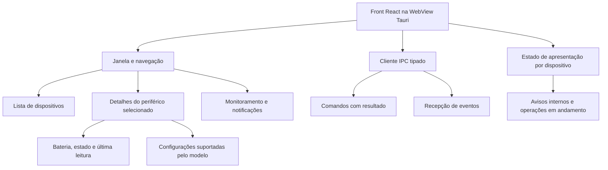
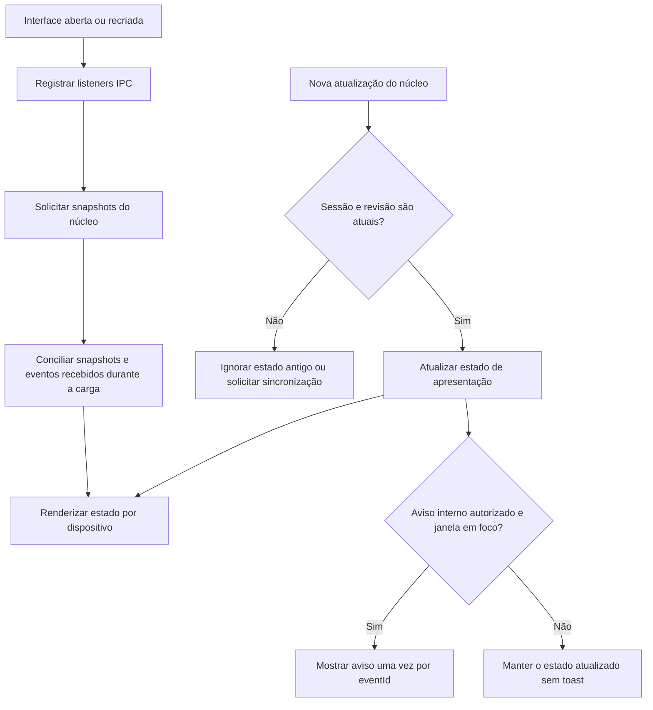
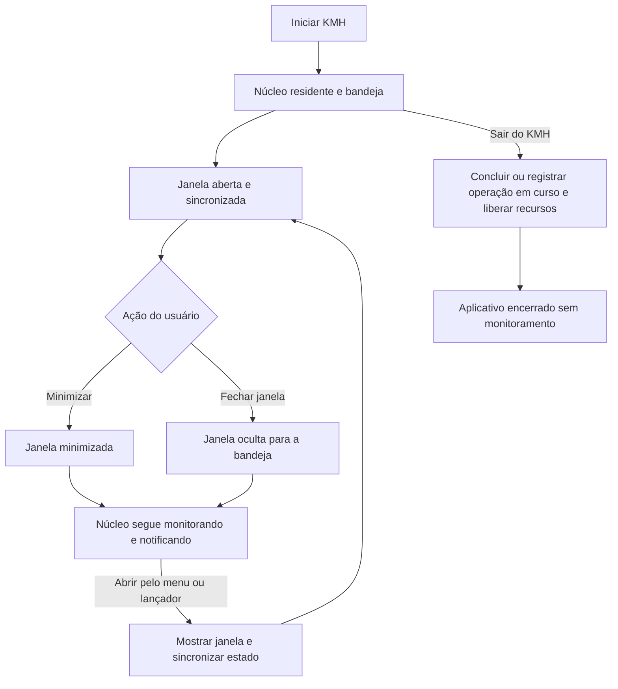

# KMH Project — Arquitetura do front

**Status: proposta de desenvolvimento, atualizada em 2026-10-17.**

O front será desenvolvido em **React + TypeScript + Vite**, reaproveitando a interface atual dentro de uma WebView do **Tauri 2**. Ele apresenta estados e configurações; o [núcleo Rust](arquitetura-nucleo.md) executa o monitoramento e a comunicação com os dispositivos. A [visão geral](arquitetura-geral.md) define o contrato entre os dois blocos.

## 1. Hierarquia da interface

Uma organização inicial possível dentro de `apps/web/src` é separar `ipc`, `devices`, `settings` e componentes compartilhados conforme surgirem. O cliente IPC será a fronteira com o núcleo; componentes visuais não terão conhecimento de bytes HID nem de caminhos do sistema.

Não é necessário introduzir uma biblioteca global de estado imediatamente. Contexto e hooks React podem atender à primeira versão; crescimento e requisitos concretos orientarão essa decisão.

## 2. Informações apresentadas

A lista deverá permitir distinguir mouse, teclado, headset e múltiplas unidades do mesmo tipo. Cada item usa o `deviceId` fornecido pelo núcleo, não o nome exibido ou apenas VID/PID.

O painel do dispositivo deverá apresentar:

- Nome, conexão e estado atual: conectado, pausado, em repouso, aguardando permissão, desconectado ou com erro.
- Informações disponíveis, como bateria, DPI e polling rate configurado.
- Instante e validade da última leitura; valor desconhecido ou não suportado não vira zero.
- Configurações editáveis apenas quando houver capacidade de escrita comprovada.
- Resultado da última operação e orientação de recuperação quando o estado for incerto.

Para o MT760, a primeira implementação pode apresentar os campos já pesquisados. Ainda não deve disponibilizar gravação de polling rate ou personalização de botões como se estivessem prontas.

## 3. Comunicação e sincronização

O cliente IPC centraliza os comandos e a recepção de eventos, mantendo a mesma terminologia da [arquitetura geral](arquitetura-geral.md). O front não executará timers para consultar o hardware: ele recebe o estado mantido pelo núcleo.

Ao abrir ou recriar a interface:

1. Registrar os listeners de eventos antes de pedir o snapshot, guardando atualizações que chegarem durante a carga.
2. Solicitar a lista e os snapshots conhecidos.
3. Conciliar os dados por `deviceId`, `sessionId` e `revision`, preservando a versão mais recente de cada sessão.
4. Processar as atualizações seguintes sem reaplicar estados antigos.
5. Solicitar novo snapshot ao detectar uma inconsistência ou restabelecer a comunicação. Eventos não são uma fila durável nem substituem a sincronização inicial.

Listeners devem ser removidos no descarte dos componentes para não duplicar avisos ao reabrir a janela. O núcleo permanece ativo mesmo quando não há nenhum listener React.

### Fluxo de recebimento de informações

O front não presume que uma mudança foi originada pelo clique na interface. O usuário pode ter pressionado o botão físico de DPI ou alterado o dispositivo em outro programa; o estado recebido do núcleo prevalece sobre o último valor exibido.

## 4. Edição de configuração

A tela deve distinguir **valor observado** e **edição ainda não aplicada**. Exemplo: o dispositivo informa 1350 DPI, e o usuário preenche 1400; até o núcleo confirmar a gravação, o valor observado continua 1350.

Ao aplicar, o front envia `deviceId`, `sessionId`, `requestId`, `expectedConfigRevision` e os campos desejados por `apply_device_config`. O núcleo valida novamente todos os dados. Se a configuração mudou desde o início da edição, a interface solicita atualização e revisão do usuário em vez de sobrescrever silenciosamente.

Durante a operação, apresentar progresso e bloquear submissões conflitantes daquele dispositivo. Dispositivos independentes podem continuar sendo acompanhados. Em erro ou perda de conexão, mostrar resultado desconhecido quando apropriado; não declarar sucesso por ter recebido apenas confirmação de envio.

O resultado deverá permitir distinguir alteração confirmada, falha sem alteração, restauração confirmada e estado incerto. Fechar a janela não deve cancelar abruptamente uma gravação que o núcleo já iniciou.

## 5. Janela minimizada, oculta e aplicativo encerrado

Esses estados têm comportamentos diferentes. O gerenciamento da janela e da bandeja ficará no lado nativo do Tauri, para não depender do ciclo de vida do React.

| Ação | Interface | Núcleo |
| --- | --- | --- |
| Minimizar | Janela minimizada pelo sistema | Continua ativo |
| Fechar a janela | Ocultar para a bandeja na política inicial | Continua ativo |
| Abrir pelo menu ou iniciar outra instância | Mostrar/reabrir a janela da instância existente | Mantém as sessões existentes |
| Sair do KMH | Encerrar a interface | Finalizar tarefas com segurança e liberar dispositivos |
| Encerrar sessão do usuário ou desligar o computador | Encerrar conforme o sistema | Parar; recuperar o estado na próxima inicialização |

A primeira versão pode manter a janela oculta. Uma otimização futura pode destruí-la e recriar a WebView ao abrir. Em ambos os casos, o monitoramento e os alertas nativos pertencem ao núcleo. JavaScript em segundo plano pode sofrer suspensão; ele não é o relógio do monitoramento.

### Fluxo de ciclo de vida da janela

O menu nativo deve ter pelo menos **Abrir KMH** e **Sair do KMH**. Ele também pode mostrar um resumo dos dispositivos. No Linux, não depender exclusivamente de clique ou duplo clique no ícone: a documentação do Tauri registra diferenças nesses eventos. Oferecer abertura pelo menu e pelo lançador e testar os ambientes de desktop suportados. [Bandeja do Tauri](https://v2.tauri.app/learn/system-tray/).

A opção **Iniciar com minha sessão** configura a inicialização automática pelo núcleo. Ela não transforma o aplicativo em serviço disponível antes do login. [Autostart do Tauri](https://v2.tauri.app/plugin/autostart/).

## 6. Notificações: papel do React

Com a janela em foco, o front pode mostrar avisos como “DPI alterado para 1200” ou “Bateria do mouse em 20%”, conforme a política fornecida pelo núcleo. A lista e o painel também são atualizados.

Com a janela minimizada, oculta, sem foco ou sem WebView, o núcleo decide e solicita a notificação nativa. O React **não precisa ficar aguardando em execução** para que essa notificação exista e não deve emitir outra notificação nativa para o mesmo evento.

As preferências de notificação são editadas no front e persistidas pelo núcleo. Elas podem definir dispositivos monitorados, avisos de bateria, limite, avisos de DPI e silêncio. A política central evita repetição e considera a disponibilidade da janela; o front usa `eventId` para não repetir o mesmo aviso interno.

Permissão de notificação e foco são informações do sistema gerenciadas pelo núcleo. Se a permissão for negada, a interface deve explicar o estado e continuar mostrando os dados; bateria baixa não equivale a garantir que o sistema exibiu um popup. [Notificações do Tauri](https://v2.tauri.app/plugin/notification/).

Ao abrir novamente, mostrar o snapshot atual, não reproduzir automaticamente todos os avisos antigos como novos toasts. Um clique em uma notificação, quando suportado pelo sistema, poderá abrir o dispositivo correspondente.

## 7. Plano de desenvolvimento e validação

1. Criar o cliente IPC e adaptar os componentes atuais para snapshots e capacidades.
2. Integrar listeners, sincronização inicial, estados antigos e erros de conexão.
3. Implementar lista de dispositivos e painel, mantendo edições separadas do estado real.
4. Integrar janela, bandeja e preferências de notificações ao núcleo.
5. Disponibilizar gravações somente depois de validação do protocolo e da recuperação.

Validar janela aberta, minimizada, oculta e recriada; ausência de listeners duplicados; eventos de sessão antiga; mudanças feitas no mouse; bateria baixa sem alertas repetidos; falhas de gravação e permissão negada. Testar também notificações no aplicativo instalado, especialmente no Windows. A interface poderá ser compartilhada entre plataformas, mas o comportamento de bandeja, permissões e notificações precisa de teste em cada sistema.
