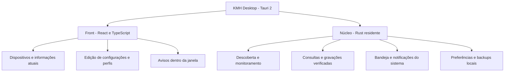
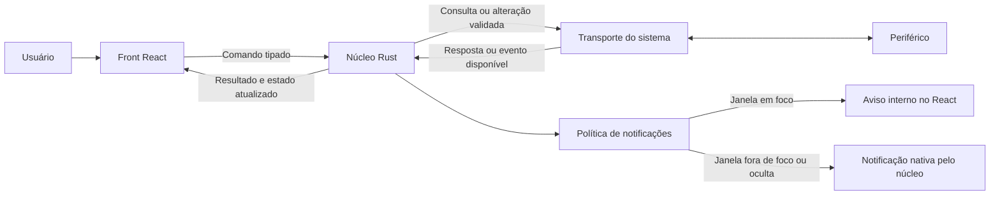
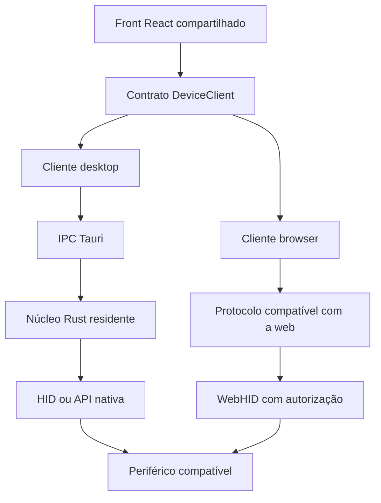

# KMH Project — Arquitetura geral

**Status: proposta de arquitetura, ainda não implementada. Atualizado em 2026-10-17.**

O KMH será um aplicativo desktop para acompanhar e configurar periféricos compatíveis no Linux, macOS e Windows. Terá dois blocos no desktop: **front em React/TypeScript** e **núcleo em Rust**, integrados pelo Tauri 2. O mesmo front também poderá ser publicado como site, usando um cliente WebHID para dispositivos com protocolo compatível e sem exigir o núcleo instalado.

A interface atual e os experimentos Python são a base de pesquisa. Já validamos no Linux a leitura de bateria, DPI e polling rate do MT760 e uma alteração de tabela DPI que persistiu após ciclo de energia, seguida de restauração. Isso não significa que o núcleo Rust ou o suporte às outras plataformas já existam. A [arquitetura da PoC](architecture.md) descreve o estado atual; o [experimento de escrita](../research/experiments/write-dpi.md) contém a evidência física.

## 1. Hierarquia dos dois blocos

Os dois blocos são partes do mesmo aplicativo instalado. As WebViews apresentam a interface; o processo nativo mantém o acesso ao sistema e o trabalho em segundo plano. A separação segue o [modelo de processos do Tauri](https://v2.tauri.app/concept/process-model/).

## 2. Papel de cada bloco

| Front | Núcleo |
| --- | --- |
| Mostra dispositivos, estados e última atualização | Descobre dispositivos e identifica o protocolo adequado |
| Exibe controles conforme as capacidades disponíveis | Decide quais operações são suportadas e valida os parâmetros |
| Envia a intenção do usuário, como alterar um valor de DPI | Monta pacotes, comunica-se com o hardware e confere o resultado |
| Mostra progresso, erros e avisos com a janela aberta | Controla filas, timeouts, reconexões e consultas periódicas |
| Edita preferências e apresenta perfis | Persiste preferências, perfis, backups e resultados |
| Recebe eventos para atualizar a tela | Detecta mudanças e pode emitir notificações nativas sem a janela |

Os componentes React não acessam HID diretamente nem enviam bytes, endereços de memória ou comandos arbitrários. Eles usam o contrato `DeviceClient`: no desktop, o cliente encaminha intenções ao núcleo por IPC; no site, uma implementação própria coordena protocolos compatíveis via WebHID. O núcleo não depende dos componentes React para continuar monitorando.

## 3. Comunicação entre front e núcleo

Usaremos o **IPC do Tauri**, sem servidor HTTP no caminho normal do aplicativo instalado. IPC é a troca de mensagens entre a interface e o processo nativo. O [Tauri oferece comandos com resposta e eventos de mudança](https://v2.tauri.app/concept/inter-process-communication/).

- **Comandos:** front solicita uma ação ao núcleo e recebe resultado ou erro. Exemplos propostos: `list_devices`, `get_device_snapshot`, `set_monitoring`, `apply_device_config`, `set_preferences`.
- **Eventos:** núcleo informa conexão, mudança de estado ou resultado de operação. Exemplos: `device_state_changed`, `dpi_changed`, `battery_low`, `configuration_applied`, `operation_failed`.
- **Snapshot:** uma fotografia completa do estado conhecido, suas capacidades e quando os campos foram lidos. A interface solicita snapshots ao abrir ou se precisar se sincronizar novamente.

Esses nomes são o contrato IPC proposto, não uma API já disponível. O contrato comum `DeviceClient` terá tipos independentes de plataforma, como `applyDeviceConfig`, traduzidos pelo cliente desktop para os comandos Rust. Os formatos IPC devem corresponder a esses tipos, por geração de bindings ou verificação de compatibilidade. O cliente browser entrega o mesmo formato de estado e declara suas próprias capacidades.

### Fluxo entre os blocos

Uma alteração só aparece como aplicada após a confirmação do núcleo. A edição na tela representa a intenção do usuário, não um valor já salvo no periférico.

## 4. Como identificar a origem das mensagens

As mensagens informam de qual dispositivo vieram, a qual conexão pertencem e quando o estado foi obtido. Assim, o front distingue dois mouses iguais e não confunde uma resposta antiga com uma nova conexão. Os identificadores e revisões estão detalhados na [arquitetura do núcleo](arquitetura-nucleo.md#4-sessões-filas-e-consultas).

## 5. Funcionamento em segundo plano

A primeira versão terá uma instância residente por usuário. Fechar a janela deverá ocultá-la para a bandeja; **Sair do KMH** deverá encerrar o aplicativo e o monitoramento. Iniciar com a sessão do usuário será uma preferência opcional.

O núcleo continuará consultando os dispositivos, detectando mudanças e emitindo notificações nativas quando necessário. O React poderá ter sua execução suspensa ou nem estar carregado; nenhuma função essencial ficará dependendo dele. Não há monitoramento quando o aplicativo está encerrado ou o computador está suspenso.

## 6. Tempo real e múltiplos periféricos

Cada dispositivo terá estado, capacidades e frequência de consulta próprios. Eventos do hardware serão aproveitados quando disponíveis; caso contrário, o núcleo consultará o dispositivo e comparará os estados. No MT760, as consultas foram comprovadas, mas notificações espontâneas de DPI/bateria não foram identificadas.

Os 1000 Hz configurados no mouse não exigem consultar bateria e configurações a cada milissegundo. As consultas devem respeitar o protocolo, o tempo de resposta e o repouso do dispositivo.

Teclados e headsets serão adicionados por implementações específicas de protocolo e, quando necessário, por adaptadores de áudio/entrada do sistema. A arquitetura extensível não implica suporte automático a qualquer modelo.

## 7. Evolução a partir da PoC

1. Portar as consultas e o experimento de configuração do MT760 para o transporte Rust, comparando bytes e resultados com as capturas existentes.
2. Resolver respostas atrasadas, reconexões e repouso antes de habilitar consultas contínuas.
3. Integrar o núcleo ao Tauri, com bandeja, IPC e preferências locais.
4. Reaproveitar o front React por meio do contrato `DeviceClient`, com cliente IPC no desktop e cliente WebHID para operações web comprovadas; manter a ponte como diagnóstico durante a transição.
5. Validar cada operação em hardware real no Linux, Windows e macOS. Botões e gravação de polling rate ainda exigem pesquisa própria.

A ponte Python permanece uma ferramenta de diagnóstico durante a migração. Inicialmente, não é necessário um serviço de sistema separado; o núcleo independente da UI permite avaliar essa divisão no futuro.

## 8. Interface compartilhada entre desktop e navegador

| Recurso | Desktop | Navegador sem núcleo |
| --- | --- | --- |
| Interface, edição e apresentação | React compartilhado | React compartilhado |
| Leitura e configuração | Núcleo, conforme suporte do modelo | Cliente WebHID, conforme protocolo, browser e permissões |
| Gravação persistente | Somente operações validadas | Somente se o protocolo permitir escrita e confirmação pela API web |
| Monitoramento com janela fechada | Núcleo residente | Sem garantia após fechar ou suspender a página |
| Bandeja e integração do sistema | Tauri e núcleo | Indisponíveis pelo contrato inicial do site |

O suporte é declarado por operação e ambiente. O front não presume que uma operação disponível no desktop funciona no browser. Não há fallback automático para outro transporte durante falhas ou gravações. No site, a permissão depende do usuário e das regras do navegador e sistema; a API não garante acesso em qualquer máquina. [WebHID](https://developer.chrome.com/docs/capabilities/hid).

Para o MT760, o teste WebHID enviou uma consulta, mas a leitura comprovada depende de `GET_REPORT(Input)` nativo, sem equivalente direto nessa API web. O cliente browser não deve anunciar suporte a essa leitura ou à gravação verificada até descobrir e validar outro caminho. Esta é uma preparação arquitetural, não a implementação da comunicação direta pelo site. Detalhes de contratos, capacidades e ciclo de vida estão na [arquitetura do front](arquitetura-front.md).

## Documentos complementares

- [Arquitetura do núcleo](arquitetura-nucleo.md): sistema operacional, dispositivos, consultas, gravação e notificações.
- [Arquitetura do front](arquitetura-front.md): interface, sincronização e comportamento da janela.
- [Retomada dos experimentos](retomada-dpi-bateria.md): reprodução do trabalho atual.
