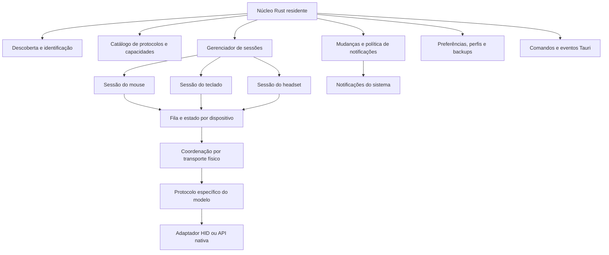
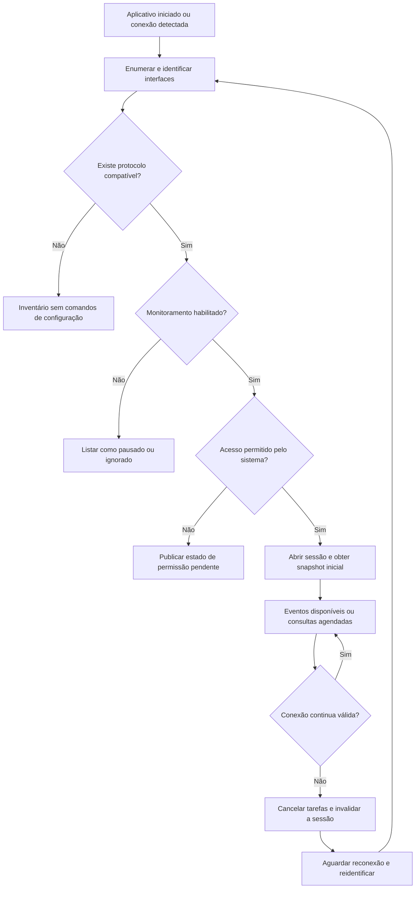
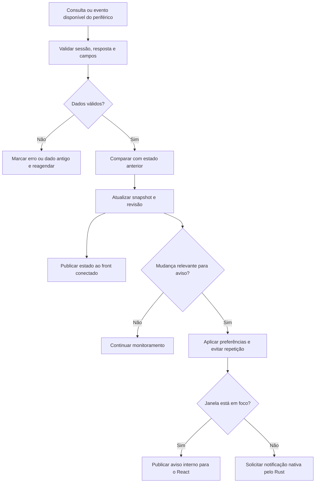

# KMH Project — Arquitetura do núcleo

**Status: proposta de implementação em Rust, atualizada em 2026-10-17.**

O núcleo será responsável pelo hardware, pelo estado dos periféricos e pela integração com o sistema operacional. Deverá continuar funcionando com a janela oculta. A [arquitetura geral](arquitetura-geral.md) define os dois blocos e os identificadores comuns; a [arquitetura do front](arquitetura-front.md) descreve quem consome seus eventos.

## 1. Hierarquia interna

Os blocos são responsabilidades internas, não serviços de rede separados. Cada sessão tem sua própria fila e estado; o desenho agrupa essas filas apenas para simplificar a leitura. Dispositivos que compartilham receptor também compartilham uma coordenação de transporte, impedindo operações incompatíveis ao mesmo tempo.

## 2. Como saber quais periféricos monitorar

O núcleo deverá manter um catálogo de protocolos implementados. Cada entrada informa como reconhecer a interface correta, quais conexões foram validadas e quais operações estão disponíveis.

A identificação combina VID/PID, interface ou coleção, usage page/usage, descritor e informações adicionais quando confiáveis. VID/PID identifica uma família, não uma unidade física única. O caminho como `/dev/hidraw5` pode mudar e não deve ser uma identidade permanente. O identificador `20220811` observado no MT760 também não está comprovado como serial único ou firmware.

Proposta de política inicial:

- Descobrir interfaces e apresentar periféricos reconhecidos.
- Monitorar automaticamente os modelos suportados, respeitando preferências salvas de pausar ou ignorar um dispositivo.
- Expor dispositivos sem suporte apenas como inventário, sem experimentar comandos sobre eles.
- Criar novas sessões após reconexão e reconciliar identidades sem fundir duas unidades iguais. Em caso de ambiguidade, não aplicar um perfil automaticamente.
- Tratar cada periférico lógico de um receptor compartilhado separadamente; sua identificação depende do protocolo desse receptor.

### Fluxo de descoberta e ciclo da sessão

Uma falha em um periférico não deve parar os demais. A interface recebe estados explícitos como conectado, aguardando permissão, em repouso, desconectado ou com erro; dado antigo não deve parecer uma leitura atual.

## 3. Comunicação com o sistema operacional

O primeiro candidato para acesso HID é HIDAPI por meio da biblioteca Rust `hidapi`. A [HIDAPI possui backends para os três sistemas](https://github.com/libusb/hidapi), e a [API Rust inclui `get_input_report`](https://docs.rs/hidapi/latest/hidapi/struct.HidDevice.html). A seleção do backend e o enquadramento dos bytes precisam ser validados em cada plataforma antes de portar nossos offsets.

| Plataforma | Integração prevista | Verificação necessária |
| --- | --- | --- |
| Linux | HIDAPI/hidraw; permissões específicas para o dispositivo | Preparar instalação com regra udev restrita e testar reconexão; não depender de ACL manual a cada uso |
| Windows | HIDAPI sobre as APIs HID nativas | Abrir a coleção do fabricante, distinguindo-a das coleções padrão reservadas ao sistema |
| macOS | HIDAPI sobre IOHIDManager | Validar abertura, compartilhamento da interface, reports e permissões exigidas para cada recurso |

No Windows, as coleções de teclado e mouse usadas pelo sistema têm restrições; a Microsoft recomenda coleções específicas do fabricante para os dados proprietários. [Documentação da Microsoft](https://learn.microsoft.com/en-us/windows-hardware/drivers/hid/keyboard-and-mouse-hid-client-drivers).

Para descobrir mudanças de conexão, usar os mecanismos do backend/sistema quando disponíveis, complementados por reenumeração controlada. Não presumir que a biblioteca HID escolhida já forneça todos os eventos de conexão necessários.

O núcleo deve permanecer como processo normal do usuário. Se uma operação de instalação precisar alterar permissões, essa etapa será específica e separada da execução cotidiana.

## 4. Sessões, filas e consultas

Uma sessão possuirá identidade lógica, `sessionId`, capacidades, estado observado e fila de operações. O acesso bloqueante ao HID ficará fora da thread da interface, em um executor de tarefas bloqueantes ou worker dedicado. Consultas para dispositivos independentes podem progredir sem bloquear uns aos outros.

O transporte também precisa de uma política testada para chamadas bloqueadas: um timeout assíncrono não garante que a chamada nativa tenha sido interrompida. Usar limites oferecidos pelo backend e descartar resultados tardios. Se o backend não permitir recuperação confiável dentro do processo, avaliar um worker isolado; essa decisão depende do protótipo, não deve ser presumida como resolvida pelo runtime Rust.

Para um mesmo transporte, permitir somente uma transação de protocolo por vez. Gravações têm prioridade sobre consultas pendentes, sem interromper uma transação em andamento. Consultas vencidas devem ser descartadas ou agrupadas, não acumuladas em uma fila infinita.

O estado deverá separar:

- Valor conhecido e instante de leitura de cada campo.
- Qualidade: válido, antigo, desconhecido, não suportado ou indisponível.
- `revision` do estado e `configRevision` dos campos de configuração.
- Perfil desejado pelo usuário e configuração realmente observada no hardware.

O contrato de mensagens deverá incluir os identificadores abaixo. `deviceId` identifica o periférico lógico e `sessionId` muda a cada reconexão. As revisões comparam dados da mesma sessão, e a revisão de configuração é separada para uma leitura de bateria não invalidar uma edição de DPI.

| Campo | Finalidade |
| --- | --- |
| `deviceId` | Identifica o periférico lógico; o núcleo deve distinguir instâncias iguais |
| `sessionId` | Impede que respostas de uma conexão antiga sejam aplicadas na conexão atual |
| `revision` | Ordena snapshots e atualizações de estado dentro da sessão |
| `configRevision` | Identifica a versão da configuração; evita salvar uma edição sobre configuração já alterada |
| `requestId` | Relaciona uma solicitação de configuração ao seu resultado |
| `eventId` | Permite evitar a apresentação repetida do mesmo aviso |
| `capturedAt` | Indica quando o estado foi obtido; validade dos campos também deve estar explícita |

Os identificadores de sessão e revisão do aplicativo não substituem a correlação de pacotes HID. No MT760, respostas antigas de mesmo tamanho continuam sendo uma limitação aberta. Antes de habilitar consultas contínuas, testar validação de etapas, descarte de respostas incompatíveis e recuperação sem repetir gravações incertas.

### Frequências iniciais para medir, não garantias

| Informação | Política proposta |
| --- | --- |
| DPI ativo | Evento, se existir; caso contrário, consultas a cada 1–2 segundos com a janela aberta, ajustadas à latência |
| Bateria | Consultas a cada 30–60 segundos, ajustadas ao dispositivo |
| Tabela DPI e polling rate configurado | Na conexão, após alteração e em verificações mais espaçadas |
| Janela oculta | Reduzir cadência sem interromper alertas habilitados |
| Repouso, erro ou desconexão | Recuar as tentativas e preservar o repouso quando o protocolo permitir |

A cadência não deve superar a capacidade real de resposta. No estado atual, o MT760 exige consultas; não identificamos eventos espontâneos para esses campos. Os 1000 Hz configurados para o mouse não são a cadência das consultas de estado.

## 5. Mudanças e notificações do sistema

A comparação ocorre no núcleo, que é a fonte do estado. O primeiro snapshot estabelece uma referência; não deve anunciar DPI alterado apenas porque o app acabou de iniciar. Uma bateria já baixa no início pode gerar um único alerta, conforme a preferência do usuário.

### Fluxo de detecção e aviso

Proposta para bateria: limite inicial de 20%, um alerta ao cruzá-lo e rearmamento somente após recuperar margem, por exemplo acima de 25%. Essa diferença evita novos avisos a cada oscilação. Os limites são preferências propostas. Reconectar não deve provocar uma sequência de alertas repetidos; o núcleo conserva o controle de repetição para o dispositivo reconhecido.

O núcleo será o único responsável pelas notificações nativas dos dispositivos. Com janela em foco, React pode mostrar um aviso interno; sem foco, o núcleo usa a integração nativa. Preferências podem desabilitar avisos de DPI, bateria ou de um dispositivo específico. Cada aviso terá `eventId`, e avisos próximos poderão ser agrupados. Ações de DPI iniciadas pelo próprio app podem usar apenas o resultado da operação para evitar aviso duplicado.

O [plugin de notificações do Tauri](https://v2.tauri.app/plugin/notification/) permite essa integração; permissões e bloqueios do sistema precisam ser respeitados. No Windows, validar também o aplicativo instalado, conforme as limitações documentadas do plugin. Se um aviso for negado ou suprimido pelo sistema, o estado continua disponível na interface; não prometer que toda notificação será exibida.

## 6. Gravações e perfis

`apply_device_config` receberá uma intenção, como o valor de um estágio DPI, nunca um pacote livre. O núcleo deverá:

1. Conferir sessão, capacidade e `configRevision` esperada pelo front.
2. Validar valores e ler o estado antes de alterar.
3. Salvar backup e intenção em armazenamento local antes do envio.
4. Suspender consultas concorrentes, enviar e conferir ACK e leitura posterior.
5. Publicar sucesso apenas após confirmação. Diante de falha, registrar estado incerto e tentar restauração somente quando o estado permitir uma recuperação conhecida.

Não reenviar automaticamente uma gravação cujo resultado ficou incerto, nem aplicar perfis em toda consulta ou reconexão. Persistência após perda de energia é uma verificação própria do protocolo. O [teste atual](../research/experiments/write-dpi.md) comprovou esse comportamento no conjunto observado, sem identificar o chip de memória.

Preferências, perfis e backups podem começar em JSON versionado com escrita atômica. Configurações permanentes de uma sessão anterior não devem ser confundidas com estado recém-lido.

## 7. Expansão para outros periféricos

O catálogo deverá declarar capacidades separadas para leitura e escrita. Hoje, ler polling rate é comprovado; gravá-lo não é. Botões, teclados e headsets ainda precisam de implementação própria.

Priorizar funções gravadas no dispositivo. Remapeamento ou macros executados pelo computador são outra capacidade e podem exigir APIs específicas de entrada e permissões adicionais. Não presumir que emitir um evento HID permita interceptar ou substituir entradas normais do sistema.

Para headsets, configurações proprietárias podem usar HID, enquanto volume, dispositivos de áudio e outros recursos podem exigir APIs de áudio do sistema. Não forçar toda a categoria a caber no transporte HID.

## 8. Critérios de entrega

- Paridade com as capturas e resultados do MT760 no Linux, seguida de validação física no Windows e macOS.
- Reconexão e suspensão/retomada sem reutilizar respostas da sessão antiga.
- Isolamento de dispositivos independentes e serialização de receptor compartilhado.
- Núcleo ativo com a janela oculta; sair encerra tarefas e libera handles.
- Notificações sem repetição, inclusive sem React, e comportamento previsível quando a permissão é negada.
- Falha durante escrita deixa backup e diagnóstico suficientes para recuperação; nenhuma gravação automática ao consultar estado.
